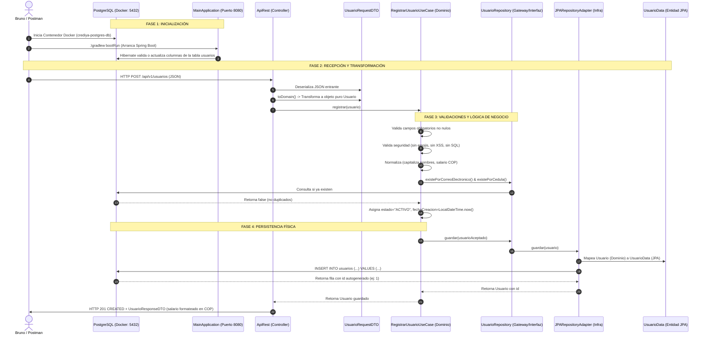

# 📘 DOCUMENTACIÓN TÉCNICA MAESTRA: CREDIYA AUTENTICACIÓN MS

> **Proyecto:** `CrediYa-autenticacion.ms`  
> **Patrón Arquitectónico:** Clean Architecture (Hexagonal / Puertos y Adaptadores)  
> **Framework:** Spring Boot 3.x / Java 17  
> **Base de Datos:** PostgreSQL 16 (Docker)  
> **Propósito:** Registro y autenticación de usuarios con reglas de seguridad y persistencia relacional.

---

## 🧭 1. ESTRUCTURA Y UBICACIÓN FÍSICA DE CARPETAS

La aplicación está dividida en capas concéntricas según Clean Architecture. En el explorador de archivos o en IntelliJ, las rutas son:

```
CrediYa-autenticacion.ms/
│
├── docker-compose.yml                                  <-- Configuración del contenedor PostgreSQL
│
├── applications/
│   └── app-service/                                    <-- Módulo Orquestador (Arranca Spring Boot)
│       └── src/main/java/co/com/crediya/
│           └── MainApplication.java                   <-- Punto de entrada de la app
│
├── infrastructure/
│   ├── entry-points/
│   │   └── api-rest/                                   <-- Capa de Entrada (Adaptadores de Entrada)
│   │       └── src/main/java/co/com/crediya/api/
│   │           ├── ApiRest.java                        <-- Controlador REST (Ventanilla HTTP)
│   │           ├── GlobalExceptionHandler.java         <-- Capturador global de errores
│   │           └── dto/
│   │               ├── UsuarioRequestDTO.java          <-- Formulario de datos que entra
│   │               └── UsuarioResponseDTO.java         <-- Respuesta que se entrega al cliente
│   │
│   └── driven-adapters/
│       └── jpa-repository/                             <-- Capa de Persistencia (Adaptador de Salida)
│           └── src/main/java/co/com/crediya/jpa/
│               ├── UsuarioData.java                    <-- Entidad JPA / Tabla de la base de datos
│               ├── JPARepository.java                  <-- Interfaz de consultas automáticas de Spring Data
│               └── JPARepositoryAdapter.java           <-- Implementación que guarda en PostgreSQL
│
└── domain/
    ├── model/                                          <-- Modelos puros y Contratos
    │   └── src/main/java/co/com/crediya/model/usuario/
    │       ├── Usuario.java                            <-- Modelo puro del negocio
    │       └── gateways/
    │           └── UsuarioRepository.java              <-- Puerto / Gateway (Interfaz requerida)
    │
    └── usecase/                                        <-- El Cerebro de la aplicación
        └── src/main/java/co/com/crediya/usecase/registrarusuario/
            └── RegistrarUsuarioUseCase.java            <-- Todas las validaciones y reglas
```

---

## 🔄 2. DIAGRAMA DE SECUENCIA DEL FLUJO COMPLETO



---

## 🚶‍♂️ 3. PASO A PASO DETALLADO (DESDE CERO HASTA LA BD)

### PASO 1: Encendido de la Base de Datos (Docker)
* **Archivo:** `docker-compose.yml` (en la raíz).
* **Comando:** `docker start crediya-postgres-db` (o `docker compose up -d`).
* **Qué ocurre:** Se levanta una instancia de PostgreSQL versión 16 en el puerto local `5432`, base de datos `crediya_autenticacion`, con credenciales `crediya_user` y `crediya_password`.

### PASO 2: Encendido del Microservicio (Spring Boot)
* **Archivo:** `applications/app-service/src/main/java/co/com/crediya/MainApplication.java`
* **Comando:** `.\gradlew bootRun`
* **Qué ocurre:**
  1. La anotación `@SpringBootApplication` inicia el escaneo de componentes.
  2. Spring Boot levanta el servidor web Apache Tomcat en el puerto `8080`.
  3. Hibernate se conecta a PostgreSQL usando el pool de HikariCP y valida la tabla `usuarios`.
  4. La aplicación queda a la espera en `http://localhost:8080`.

### PASO 3: Llegada de la Petición HTTP (Entry Point)
* **Archivo:** `infrastructure/entry-points/api-rest/src/main/java/co/com/crediya/api/ApiRest.java`
* **El cliente envía:** Un `POST` a `/api/v1/usuarios` con el cuerpo en formato JSON.
* **Qué ocurre:**
  1. `@RestController` y `@RequestMapping("/api/v1/usuarios")` capturan la llamada.
  2. `@RequestBody UsuarioRequestDTO requestDTO` toma el JSON y lo deserializa.
  3. Se ejecuta `Usuario usuario = requestDTO.toDomain();` para convertir el objeto web a modelo puro de dominio.
  4. 👉 **Método que transfiere el flujo al dominio:**
     ```java
     Usuario usuarioCreado = registrarUsuarioUseCase.registrar(usuario);
     ```

### PASO 4: Reglas de Negocio y Seguridad (Dominio)
* **Archivo:** `domain/usecase/src/main/java/co/com/crediya/usecase/registrarusuario/RegistrarUsuarioUseCase.java`
* **Qué ocurre en el método `registrar(usuario)`:**
  1. **Campos obligatorios:** Verifica que ningún dato venga nulo o vacío (`trim().isEmpty()`).
  2. **Seguridad contra ataques:**
     * `EMOJI_PATTERN`: Rechaza emojis y caracteres gráficos no textuales.
     * `CARACTERES_PELIGROSOS`: Bloquea intentos de inyección XSS o SQL (`<`, `>`, `'`, `"`, `;`, `\`).
  3. **Formatos estrictos:**
     * `NOMBRE_PATTERN`: Solo letras (con soporte Unicode para tildes y eñes).
     * `CEDULA_PATTERN`: Entre 6 y 12 dígitos numéricos continuos.
     * `TELEFONO_PATTERN`: Exactamente 10 dígitos numéricos.
     * `validarEdad`: Entre 18 y 120 años calculados mediante `Period.between`.
  4. **Normalización (Peluquería):**
     * Capitaliza nombres y apellidos (ej: `"samuel salazar"` pasa a `"Samuel Salazar"`).
     * Redondea el salario a exactamente 2 decimales usando `RoundingMode.HALF_UP`.
  5. **Comprobación de Unicidad:**
     * Llama a `usuarioRepository.existePorCorreoElectronico(...)` y `usuarioRepository.existePorCedula(...)`. Si ya existen, frena arrojando `BusinessException`.
  6. **Construcción oficial:**
     * Le estampa `estado("ACTIVO")` y la fecha del servidor `fechaCreacion(LocalDateTime.now())`.
  7. 👉 **Método que transfiere el flujo a la base de datos:**
     ```java
     return usuarioRepository.guardar(usuarioAceptado);
     ```

### PASO 5: Mapeo y Persistencia en PostgreSQL (Driven Adapter)
* **Archivos:**
  * Contrato (Puerto): `domain/model/.../gateways/UsuarioRepository.java`
  * Adaptador: `infrastructure/driven-adapters/jpa-repository/.../JPARepositoryAdapter.java`
  * Entidad Relacional: `infrastructure/driven-adapters/jpa-repository/.../UsuarioData.java`
* **Qué ocurre:**
  1. `JPARepositoryAdapter` implementa la interfaz `UsuarioRepository`.
  2. Su método `guardar` toma el `Usuario` del dominio y mediante `ObjectMapper` lo traduce a `UsuarioData` (la clase mapeada con `@Entity` y `@Table`).
  3. Ejecuta `super.save(usuario)`, ordenándole a Hibernate generar el SQL:
     ```sql
     INSERT INTO usuarios (nombres, apellidos, cedula, telefono, correoelectronico, salariobase, estado, fechacreacion)
     VALUES (?, ?, ?, ?, ?, ?, ?, ?);
     ```
  4. PostgreSQL graba la fila y genera el `id` autoincrementable.
  5. El adaptador recibe el registro guardado, lo convierte de nuevo a `Usuario` y lo retorna hacia arriba.

### PASO 6: Respuesta al Cliente (Response DTO)
* **Archivo:** `infrastructure/entry-points/api-rest/.../dto/UsuarioResponseDTO.java`
* **Qué ocurre:**
  1. El controlador `ApiRest` recibe el `Usuario` con su nuevo ID.
  2. Llama a `UsuarioResponseDTO.exitoso(usuarioCreado)`.
  3. Este DTO toma el salario numérico y mediante `NumberFormat.getCurrencyInstance(new Locale("es", "CO"))` lo transforma a formato moneda colombiana (ej: `$ 1.500.000,00`).
  4. El servidor responde con status HTTP `201 CREATED` y el JSON final.

---

## 🔬 4. CONCEPTOS Y MÉTODOS "RAROS" PARA SUSTENTAR AL PROFESOR

| Concepto / Método | Dónde está ubicado | Explicación Técnica y Por Qué se Usó |
| :--- | :--- | :--- |
| **`toBuilder()`** | `Usuario.java` | Viene de Lombok (`@Builder(toBuilder = true)`). Permite clonar un objeto existente y modificar propiedades específicas sin mutar el original, garantizando la inmutabilidad en el Dominio. |
| **`\p{So}` (Regex Unicode)** | `RegistrarUsuarioUseCase.java` | Expresión regular POSIX para símbolos diversos (*Symbol, Other*). Se usa para detectar y prohibir cualquier emoji a nivel de bytes. |
| **Escapes Unicode (`\u00e1`, etc.)** | `RegistrarUsuarioUseCase.java` | En lugar de escribir tildes directamente en el código fuente (`á`, `é`), se escriben sus códigos hexadecimales para que el compilador no falle por codificación de caracteres en Windows (Windows-1252 vs UTF-8). |
| **`RoundingMode.HALF_UP`** | `RegistrarUsuarioUseCase.java` | Regla estándar bancaria para `BigDecimal`. Redondea hacia arriba si el decimal descartado es 5 o superior, evitando pérdida de centavos. |
| **`@PrePersist`** | `UsuarioData.java` | Gancho de ciclo de vida de JPA. Se ejecuta automáticamente en la entidad segundos antes del `INSERT`, como salvaguarda para asignar la fecha y hora si viniera nula. |
| **`AdapterOperations<...>`** | `JPARepositoryAdapter.java` | Clase genérica de Bancolombia que automatiza la conversión y operaciones CRUD entre el modelo de dominio y la entidad de base de datos. |
| **`@RestControllerAdvice`** | `GlobalExceptionHandler.java` | Interceptor global de errores de Spring. Atrapa las `BusinessException` del caso de uso y las transforma en respuestas HTTP 400 Bad Request limpias en formato JSON. |
